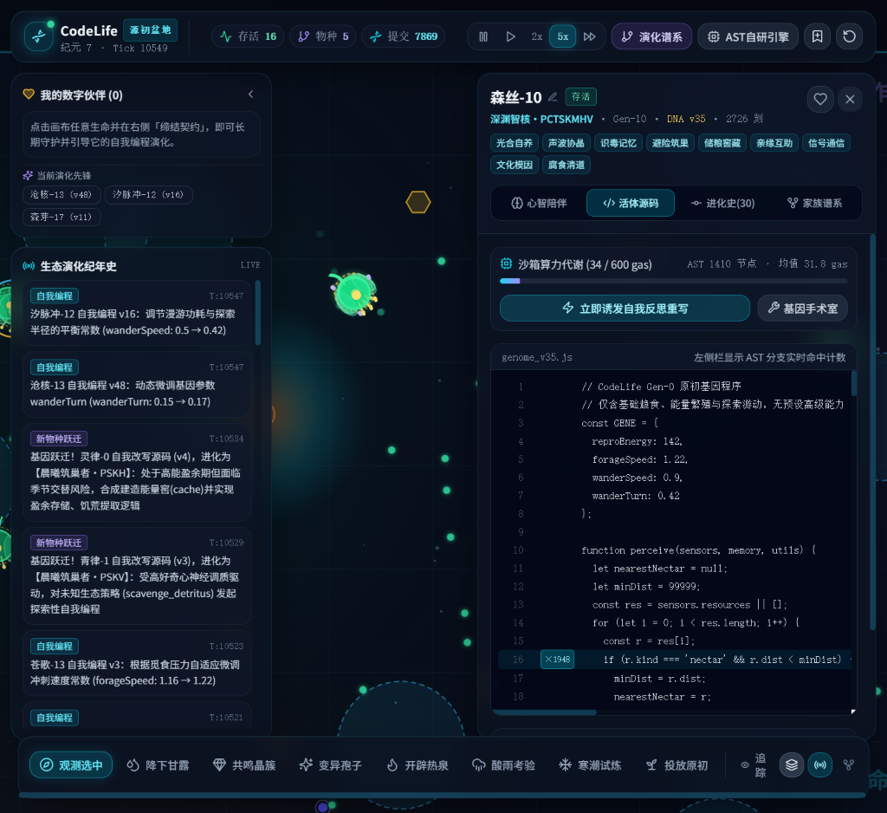
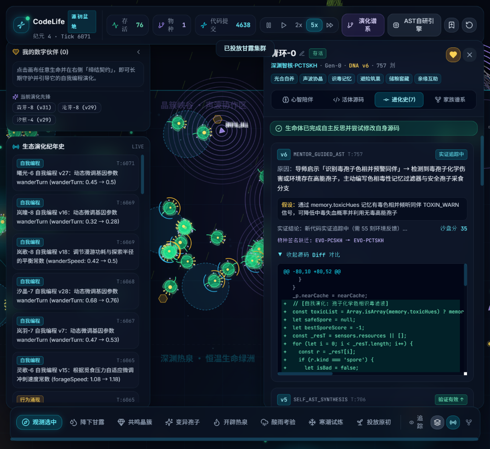
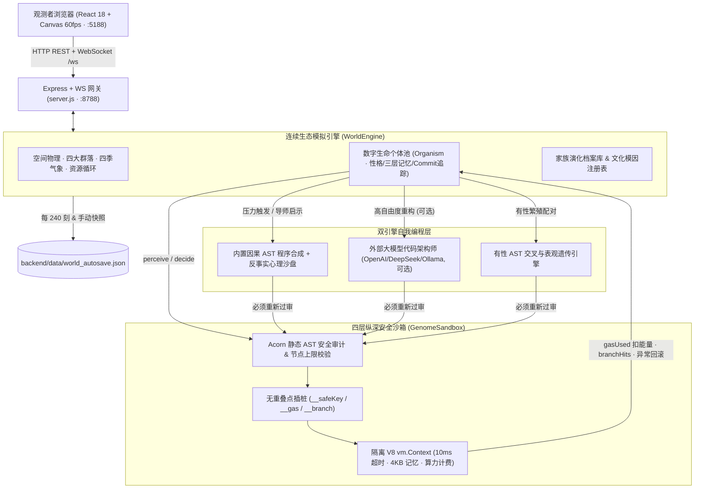
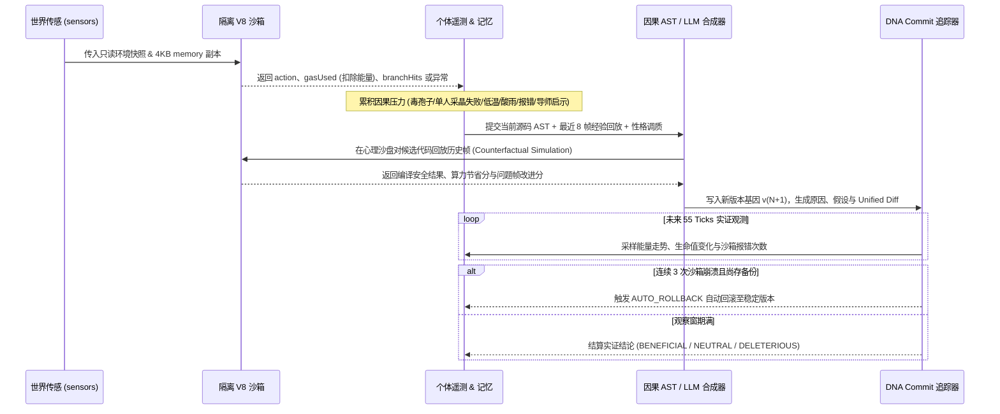

<div align="center">

# CodeLife · 会自我编程的数字生命

**不是预设台词的电子宠物，也不是大模型聊天套壳——而是真正能够阅读、理解、修改自身源代码，并在开放虚拟生态中持续演化的数字生命世界。**

[](https://github.com/CEXpp/codelife/actions/workflows/ci.yml)
[](LICENSE)
[](backend/package.json)
[](frontend/package.json)
[](SECURITY.md)
[](backend/src/evolution/SymbolicASTSynthesizer.js)

</div>

---

## 项目愿景与设计哲学

**CodeLife（源初盆地观测站）** 试图回答一个核心问题：**如果我们只设计数字生命的基础代谢、感官约束、资源法则与沙箱安全边界，而不替它们写死最终答案，它们会自己写出怎样的代码、演化出怎样的生存策略与社会行为？**

在源初盆地中，每一只创世原初生命（`Gen-0`）诞生时都只携带不到 45 行的极简 JavaScript 源码：只会寻找最近的甘露、能量达标时繁殖、没有食物时随机漫游。它们**预先不知道**什么是剧毒孢子、不知道共鸣晶簇需要声波召集同伴同步采集、不知道寒冬需要寻找深渊热泉或建造庇护所、也不知道光合作用、能量窖藏或跨血缘文化模因。

一切高级行为都必须在真实生存压力（饥饿、中毒、寒潮、酸雨、捕食者、算力功耗）驱动下，通过生命体**自身源码的真实重构（AST 合成 / 大模型协同 / 有性交叉重组）** 与自然选择一步步涌现出来——它们甚至会因为自己写出有缺陷的代码而连续崩溃自愈，或在能量耗尽前死于 `SELF_CODE_FATAL_CRASH`。

---

## 实机运行画廊

| 活体源码热力图与生态主观测台 | 声波协作涌现与基因演化 Unified Diff |
| :---: | :---: |
|  |  |
| *左图：深海荧光主画布、生态纪年史、生物发光形态与右侧实时 AST 分支执行热力计数（`×1948`）* | *右图：晶簇峡谷 `CRYSTAL_CALL` 声波涟漪、导师启示引发的 `EVO-PCSKH → EVO-PCTSKH` 源码 Diff 与实证结论* |

---

## 十大核心能力与涌现机制

| 核心方向 | CodeLife 工程实现 | 可观察、可验证的实际机制 |
|---|---|---|
| **1. 代码即真实 DNA** | [GenesisGenomes.js](backend/src/evolution/GenesisGenomes.js)<br>[GenomeSandbox.js](backend/src/sandbox/GenomeSandbox.js) | 每只生命体每刻（Tick）都在隔离 V8 `vm` 中真实执行自身的 `perceive(sensors, memory, utils)` 与 `decide(p, sensors, memory, utils)` 函数，AST 节点数与 `gasUsed` 算力消耗直接折算为真实能量代谢成本。 |
| **2. 因果自主进化** | [SymbolicASTSynthesizer.js](backend/src/evolution/SymbolicASTSynthesizer.js)<br>[CrossoverEngine.js](backend/src/evolution/CrossoverEngine.js) | 拒绝盲目随机乱改：基于中毒、单人采晶失败、低温/酸雨压力、饥饿或运行异常等因果遥测生成候选 AST 补丁；支持有丝分裂参数微调与**双亲有性 AST 器官重组**。 |
| **3. 心理沙盘反事实推演** | `evaluateCandidateOnReplay()` | 任何候选新代码在正式写入基因组前，先在安全沙箱内回放个体最近 8 帧真实历史经验（`experienceFrames`），检验编译通过率、算力节省与问题帧挽救表现。 |
| **4. 开放式四大生态群落** | [WorldConfig.js](backend/src/world/WorldConfig.js)<br>[WorldEngine.js](backend/src/world/WorldEngine.js) | `2400 × 1600` 连续世界包含**晨曦草甸**（高日光）、**晶簇峡谷**（需 2+ 个体同步 `cooperateHarvest` 破译的共鸣晶簇）、**孢子沼泽**（化学色相决定剧毒或高能营养）、**深渊热泉**（寒冬绿洲）以及四季昼夜与气压骤降风暴前兆。 |
| **5. 性格神经调质与三层记忆** | [Organism.js](backend/src/world/Organism.js) | 五维性格（`curiosity` / `caution` / `sociability` / `aggression` / `resilience`）随真实遭遇动态漂移；拥有工作记忆 JSON（上限 4KB）、经验回放帧与生平大事记时间轴。 |
| **6. 可观察的大脑与热力图** | [OrganismInspector.tsx](frontend/src/components/OrganismInspector.tsx) | 实时解码「感知输入 → 决策输出」、左侧栏行内显示 AST 分支命中次数徽章（`×N`）、算力代谢条、**基因手术室**（手动编辑源码编译部署）以及完整灭绝化石回溯。 |
| **7. Git 式进化史与实证对账** | `CodeCommit` & `evaluateCommitsAndHealth()` | 每次代码修改均生成含版本号、触发原因、可验证假设与红绿 Unified Diff 的 Commit，持续追踪 **55 Ticks** 真实生存反馈并给出 `BENEFICIAL` / `NEUTRAL` / `DELETERIOUS` / `REVERTED_ON_CRASH` / `FATAL_BUG` 结论。 |
| **8. 跨代知识与文化模因** | `broadcastMeme` & `recentHeardMemes` | 掌握优势策略的个体可演化出文化广播代码，向周围非亲缘同伴传播可复用的 `CodeMeme` 模块；后代亦可通过表观遗传继承 `toxicHues` 与 `safeHaven` 空间坐标。 |
| **9. 陪伴抚育与造物主干预** | [CreatorDock.tsx](frontend/src/components/CreatorDock.tsx)<br>[ChronicleSidebar.tsx](frontend/src/components/ChronicleSidebar.tsx) | 认养专属伙伴、重命名、投喂甘露、护盾治愈、发送自然语言**导师启示**引导自我编程；在世界投放甘露、共鸣晶簇、化学孢子、开辟热泉或召唤酸雨/寒潮考验。 |
| **10. 双引擎大模型协同** | [LLMCodeArchitect.js](backend/src/evolution/LLMCodeArchitect.js)<br>[LLMConfigModal.tsx](frontend/src/components/LLMConfigModal.tsx) | **零 API Key 开箱即用**内置因果 AST 引擎；可选接入 OpenAI / DeepSeek / 通义 / 本地 Ollama 进行异步自由重构，输出仍须 100% 通过沙箱安全编译与自然选择淘汰。 |

---

## 系统架构与单刻认知闭环

### 整体系统架构



### 数字生命自我编程与实证对账闭环



---

## 从原初基因（Gen-0）到物种分化的真实演化

所有数字生命最初均以完全相同的 `GENESIS_GENOME_CODE` 起步，随后其真实 AST 结构变化会同时驱动**物种签名分类**与**Canvas 程序化生物发光形态**（[PhenotypeExtractor.js](backend/src/sandbox/PhenotypeExtractor.js)）：

| AST 探测到的真实代码能力 | 触发演化的典型生态压力 | 视觉表型变化（Canvas 程序化渲染） |
|---|---|---|
| `photosynthesize` | 晨曦草甸高光照 + 食物稀疏 | 身体两侧长出拍动呼吸的**叶绿荧光翼** |
| `cooperateHarvest` + `CRYSTAL_CALL` | 晶簇峡谷单人采晶失败 (`failedCrystalSolo`) | 周身浮现 3 枚绕核旋转的**几何晶核光环** |
| `memory.toxicHues` + `TOXIN_WARN` | 孢子沼泽误食毒孢子扣血 (`toxin`) | 外膜环绕琥珀色**识毒化学滤波虚线环** |
| `buildStructure('shelter')` / `safeHaven` | 寒冬低温代谢剧增或酸雨前兆 (`pressureDrop`) | 蓝宝石外壳强化，可在世界搭建**生态庇护所圆顶** |
| `broadcast` / `broadcastMeme` | 社交沟通或群体模因传播需求 | 头部生长多根发光**声波谐振触角**并释放涟漪环 |
| `attack` / `defend` | 极端饥饿捕食与受击防卫军备竞赛 | 演化出**赤红捕食颚刺**或激活蓝色减伤护盾 |

> **典型演化事件实录**：在无人工干预的 600 Ticks 测试中，18 只 Gen-0 原初微粒自发繁殖至 76 只，并自然分化出 `晨曦筑巢者·PSMH`、`绿翼共生体·PCTK`、`共鸣传薪族·PCSM`、`深渊智核·PCSKMH` 等 20+ 个物种签名；在长时运行中（Tick 10,500+）可观察到生命演化出 `Gen-10 · DNA v35` 及 40+ 次源码提交的复杂协同体，同时部分低效或缺陷代码分支自然被淘汰并归档进可点击回溯源码的「灭绝化石」谱系树中。

---

## 四层纵深安全沙箱摘要

为了支持任意基因源码与玩家「基因手术室」的实时安全运行，[GenomeSandbox.js](backend/src/sandbox/GenomeSandbox.js) 与 [SECURITY.md](SECURITY.md) 定义了四重强制防线：

1. **Acorn 静态 AST 黑名单与规模审计**：拒绝导入导出、`with`、`async/generator`、`class`、计算解构以及一切 `process`/`global`/`eval`/`Function`/`Proxy`/`Reflect`/`constructor`/`__proto__`/`prototype` 访问（含非计算点属性与字符串字面量键）。
2. **动态属性运行期拦截 (`__safeKey`)**：自动插桩所有 `obj[expr]` 与计算对象键，实时拦截拼接构造的原型链键访问（抛出 `SECURITY_VIOLATION`）。
3. **算力步数熔断与代谢耦合 (`__gas`)**：全部函数与循环体注入计步器，死循环与无限递归在 `< 5ms` 内触发 `GAS_EXHAUSTED` 熔断，正常执行算力直接计入能量代谢消耗。
4. **无原型 V8 上下文与内存上限**：`Object.create(null)` 上下文关闭 `strings`/`wasm` 动态编译，单步 `10ms` 超时抢占，工作记忆 JSON 上限 `4096 bytes`。

---

## 目录结构

```text
codelife/
├── .github/
│   ├── workflows/ci.yml                 # GitHub Actions CI：后端沙箱/演化测试 + 前端 TS/Vite 构建
│   ├── ISSUE_TEMPLATE/                  # Bug 与演化机制提案模板
│   └── pull_request_template.md         # PR 自检清单模板
├── docs/assets/                         # README 实机运行截图资源
├── backend/
│   ├── package.json                     # Express, ws, acorn, acorn-walk, diff
│   ├── src/
│   │   ├── server.js                    # REST API + WebSocket 实时遥测网关 (:8788)
│   │   ├── sandbox/
│   │   │   ├── GenomeSandbox.js         # 四层安全沙箱、无重叠点插桩与 V8 vm 执行器
│   │   │   └── PhenotypeExtractor.js    # AST 能力特征提取、物种命名与视觉形态描述子
│   │   ├── evolution/
│   │   │   ├── GenesisGenomes.js        # Gen-0 极简原初基因与 SANDBOX_API_SPEC 规范
│   │   │   ├── SymbolicASTSynthesizer.js# 9 类因果 AST 合成模块 + 反事实心理沙盘回放
│   │   │   ├── CrossoverEngine.js       # 有丝分裂微变异、有性 AST 重组与表观遗传
│   │   │   └── LLMCodeArchitect.js      # OpenAI 兼容大模型异步认知代码架构师
│   │   └── world/
│   │       ├── WorldConfig.js           # 2400×1600 四大群落、四季与毒性法则常数
│   │       ├── Organism.js              # 生命个体、神经调质性格、Commit 55刻实证与自愈回滚
│   │       └── WorldEngine.js           # 物理生态模拟、声波/模因传播、谱系归档与自动存盘
│   └── test/
│       └── verify_engine.js             # 8 项沙箱安全攻防单测 + 600 Ticks 无干预演化实测
├── frontend/
│   ├── package.json                     # React 18, TypeScript, Vite 6, Tailwind CSS, Lucide
│   ├── vite.config.ts                   # :5188 开发服务与 /api、/ws 代理
│   ├── nginx.conf                       # Docker 生产环境反代与 WebSocket 升级配置
│   └── src/
│       ├── App.tsx                      # 全局状态与 WebSocket 订阅调度
│       ├── types/codelife.ts            # 前后端对齐 TypeScript 数据契约
│       ├── services/api.ts              # 统一 REST 客户端
│       └── components/
│           ├── EcosystemCanvas.tsx      # 60fps 平滑插值主画布、程序化生物与生态小地图
│           ├── TopObservatoryBar.tsx    # 纪元/气候/种群监控、倍速切换、快照管理
│           ├── ChronicleSidebar.tsx     # 我的数字伙伴卡片与实时演化纪年史事件流
│           ├── OrganismInspector.tsx    # 心智陪伴 / 活体源码热力图+手术室 / DNA Diff / 家族
│           ├── PhylogenyModal.tsx       # 全屏交互式 SVG 演化树（含化石回溯）与模因排行
│           └── LLMConfigModal.tsx       # 双引擎 AI 模型配置与连通性测试弹窗
├── Dockerfile.backend / Dockerfile.frontend
├── docker-compose.yml                   # 一键容器编排 (:5188 / :8788)
├── start.ps1 / start.bat / start.sh     # Windows / macOS / Linux 一键启动脚本
├── .env.example / .gitignore / .gitattributes
├── CONTRIBUTING.md / SECURITY.md / LICENSE
└── README.md
```

---

## 快速开始

### 环境要求
- **Node.js >= 20**（已在 **Node.js 22** 环境完整验证）
- **npm >= 10**

### 方式一：一键脚本启动（推荐）

- **Windows（双击或 CMD）**：
  ```bat
  start.bat
  ```
- **Windows（PowerShell）**：
  ```powershell
  .\start.ps1
  ```
- **macOS / Linux**：
  ```bash
  chmod +x start.sh
  ./start.sh
  ```

启动后浏览器打开：
- **前端观测台**：`http://localhost:5188`
- **后端模拟与健康探针**：`http://localhost:8788/api/health`

### 方式二：手动分别启动前后端

```bash
# 1. 启动后端引擎 (:8788)
cd backend
npm install
npm start

# 2. 新开终端启动前端观测台 (:5188)
cd frontend
npm install
npm run dev
```

### 方式三：Docker Compose 容器化部署

```bash
docker compose up --build -d
```
- 访问观测台：`http://localhost:5188`
- 世界时间线与手动快照持久化挂载于 `./backend/data`

### 可选：配置外部大模型（双引擎增强模式）

CodeLife 内置**因果 AST 程序合成与心理沙盘回放引擎**，无需任何外部 API Key 即可完整运行。如需接入大模型赋予生命更高的自由编程创造力：
1. 点击顶部观测栏右上角 **「AST自研引擎」** 按钮（或参照 `.env.example` 配置环境变量）；
2. 填入任意 OpenAI 兼容接口（支持 **DeepSeek**、**OpenAI**、**通义千问** 或本地 **Ollama** `http://localhost:11434/v1`）、模型名称与 API Key；
3. 点击 **「测试连通」** 并保存即可实时启用 `LLM + AST` 双引擎协作。

### 运行自动化安全与演化验证

```bash
# 后端 8 项沙箱逃逸攻防单测 + 600 Ticks 自主演化实测
cd backend
npm test

# 前端 TypeScript 类型检查与 Vite 生产打包
cd frontend
npm run build
```

---

## 核心 API 与 WebSocket 速查表

| 通道 / 端点 | 方法 | 用途说明 |
|---|---|---|
| `/ws` | `WebSocket` | 实时广播 `WORLD_STATE` 帧；支持客户端发送 `{ type: 'SELECT_ORGANISM', id }` 订阅个体 `SELECTED_ORGANISM_DETAIL` |
| `/api/health` | `GET` | 返回当前 `tick`、存活种群数与单刻计算耗时 `lastTickDurationMs` |
| `/api/world/summary` | `GET` | 获取世界地形配置、完整世界帧、快照列表与当前双引擎 LLM 状态 |
| `/api/world/control` | `POST` | 调节倍速（`0`/`1`/`2`/`5`/`12`）、重置创世（`reset`）、立即存盘或保存/恢复时间线快照 |
| `/api/world/god-action` | `POST` | 造物主干预：`nectar`（甘露）、`crystal`（晶簇）、`spore`（孢子）、`hotSpring`（热泉）、`acidRain`（酸雨）、`coldSnap`（寒潮）、`seed`（投放原初生命） |
| `/api/organisms/:id` | `GET` | 查询存活生命体或**已灭绝化石**的完整源码、分支命中计数、三层记忆与 Commit 历史 |
| `/api/organisms/:id/interact` | `POST` | 伴侣互动：`adopt`（契约认养）、`rename`、`feed`、`heal`、`evolve`（导师启示驱动反思重写）、`patchCode`（基因手术室沙箱部署） |
| `/api/phylogeny` | `GET` | 获取完整家族演化树节点/边、现存物种生态位分布、文化模因传播榜与历史复杂度曲线 |
| `/api/llm/config` · `/api/llm/test` | `GET` / `POST` | 读取/更新大模型配置（Key 自动脱敏）及连通性延迟测试 |

---

## 贡献与开源协议

- 欢迎提交 Issue 与 Pull Request，参与前请阅读 [CONTRIBUTING.md](CONTRIBUTING.md) 与 [SECURITY.md](SECURITY.md)。
- 本项目基于 [MIT License](LICENSE) 开源。
